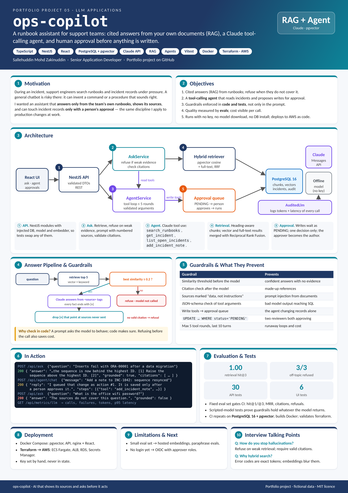

# ops-copilot

| [How to use](docs/USAGE.md) | [Design document](docs/DESIGN.md) | [Poster (PDF, A3)](docs/poster.pdf) | [Changelog](CHANGELOG.md) |
|---|---|---|---|

<a href="docs/poster.png"></a>

An AI assistant for an application support team. It answers questions from the team's runbooks with numbered
sources, and runs a tool-calling agent that can look up incidents and propose changes. Any write the agent wants
to make waits for a person to approve it.

**Stack:** TypeScript · NestJS · React 19 · PostgreSQL 16 + pgvector · Claude (Anthropic API) · Vitest · Docker ·
Terraform (AWS ECS Fargate, RDS) · GitHub Actions

## What it does

- **Ask the runbooks (RAG).** Markdown runbooks are split by heading, embedded, and stored in PostgreSQL with
  pgvector. Each question runs a semantic search and a full-text search, merges them with Reciprocal Rank Fusion,
  and sends the best passages to Claude with strict rules: cite every fact as `[n]`, refuse when the sources do not
  cover the question.
- **Agent with tools.** Claude can call `search_runbooks`, `get_incident`, `list_open_incidents` and
  `add_incident_note`. Tool arguments are validated before anything runs, the loop stops after five rounds, and
  `add_incident_note` is queued as a pending action instead of running.
- **Human approval.** Pending actions appear in the UI. Approve runs the write and records who approved it; a
  second decision on the same action is refused.
- **Guardrails you can test.** Low-confidence questions are refused without calling the model. Citations that point
  at sources the model was not given are dropped. Retrieved text is marked as data, not instructions.
- **Cost and quality visible.** Every model call is logged with tokens and latency (`/api/metrics/llm`). A fixed
  evaluation set measures retrieval hit@1, hit@3, MRR, citation coverage and refusals on every CI run.

## Quick start (no database, no API key)

```bash
cd api && npm install && npm run seed && npm run dev     # API on :3000, embedded PostgreSQL (PGlite + pgvector)
cd web && npm install && npm run dev                     # UI on http://localhost:5173
```

Without `ANTHROPIC_API_KEY` the API uses a built-in offline model that quotes the best-matching source sentences,
so everything works end to end. Set the key to use Claude:

```bash
ANTHROPIC_API_KEY=sk-ant-... npm run dev
```

Full stack with PostgreSQL: `docker compose up --build`, then open http://localhost:8080.

## Results

| Check | Result |
|---|---|
| API tests (unit, HTTP, agent, guardrails) | 30 passing |
| Web component tests | 6 passing |
| Retrieval eval (12 questions) | hit@1 = 1.00, hit@3 = 1.00, MRR = 1.00 with the built-in embedder |
| Out-of-scope questions refused | 3 / 3 |
| Same evals over node-postgres | pass (PGlite socket locally; PostgreSQL 16 + pgvector in CI) |

The eval set is small and written against these runbooks, so treat the numbers as a regression gate, not a
benchmark. [DESIGN.md](docs/DESIGN.md#7-evaluation) explains what they do and do not show.

## Repository layout

```
api/            NestJS API: RAG, agent, approvals, metrics, migrations, seed data, evals, tests
web/            React + Vite UI: ask, agent chat with approvals, incidents, documents, model usage
infra/aws/      Terraform: ECR, ECS Fargate, ALB, RDS PostgreSQL, Secrets Manager
docs/           USAGE.md, DESIGN.md, poster
docker-compose.yml
```

All runbooks and incidents in this repository are fictional.
