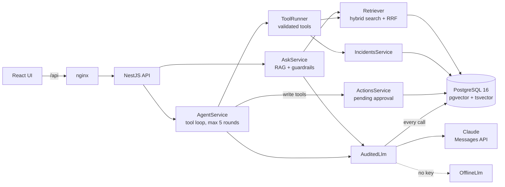
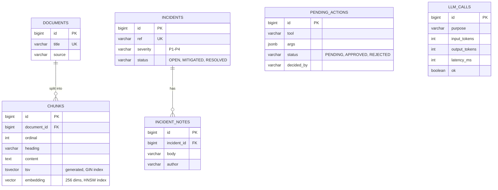
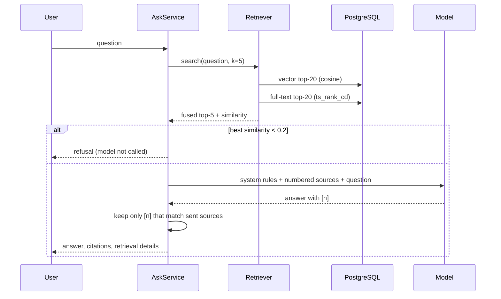
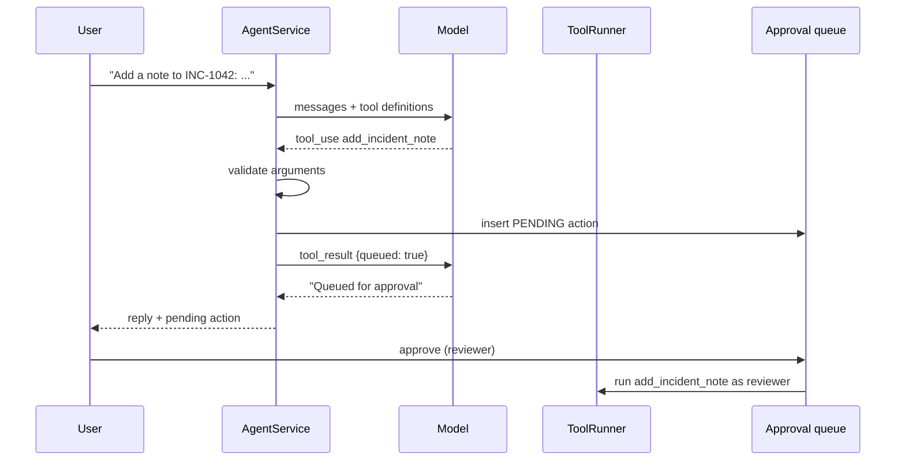
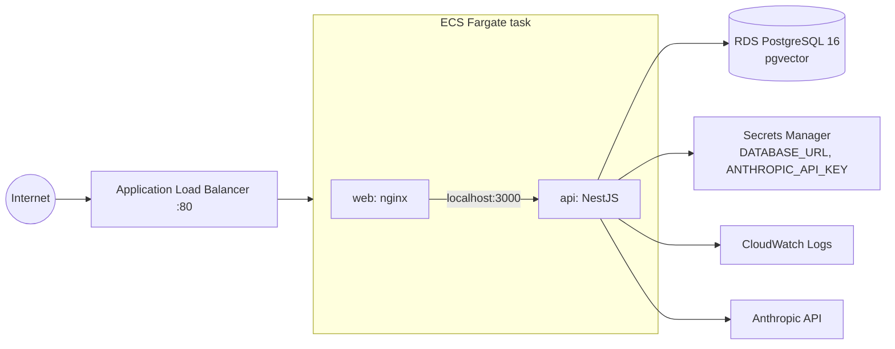

# ops-copilot: Design document

| | |
|---|---|
| Author | Sallehuddin Mohd Zakinuddin |
| Status | v1.0.0 |
| Last updated | November 2026 |

## 1. Context

Application support teams keep their knowledge in runbooks and SOPs, and their live state in incident records.
During an incident, engineers search both under pressure. A general chatbot is risky here: it can invent commands
or procedures that sound right. This project builds an assistant that answers only from the team's own documents,
shows its sources, and can act on incidents only with a person's approval. All runbooks and incidents in the
repository are fictional.

## 2. Goals and non-goals

**Goals**

1. Cited answers from Markdown runbooks, and an explicit refusal when the runbooks do not cover the question.
2. An agent that uses tools to read incidents and runbooks, and proposes writes for human approval.
3. Guardrails that are enforced in code and covered by tests, not only written in a prompt.
4. Measurable quality (evals) and visible cost (token and latency log).
5. Runs with no API key, no model download and no database install, so anyone can try it in two commands.
6. A deployment path to AWS described as code.

**Non-goals (this version)**

- Authentication and per-user permissions.
- PDF/Word ingestion; streaming responses.
- Fine-tuning or self-hosted models.

## 3. Architecture

| Component | Responsibility |
|---|---|
| `DocumentsService` | Chunk Markdown by heading, embed, store chunks and vectors |
| `Retriever` | Run vector and keyword search, fuse with RRF, return similarity for the confidence check |
| `AskService` | Refuse on weak evidence, build the cited prompt, validate citations |
| `AgentService` | Bounded tool loop; routes write tools to the approval queue |
| `ToolRunner` | Validates arguments against each tool's JSON schema, then runs the tool |
| `ActionsService` | Pending writes; one decision per action; runs the write on approval |
| `AuditedLlm` | Wraps any model client; records purpose, model, tokens, latency, success |

Every external dependency (database, model, embedder) is injected through `AppModule.register()`, so tests swap
them without mocking frameworks.

## 4. Data model

The schema is created by versioned SQL files (`api/src/db/migrations/001_init.sql`) applied once each and
recorded in `schema_migrations`, the same idea as Flyway.

## 5. Request flows

### Ask

### Agent with approval

## 6. Key decisions

| # | Decision | Alternatives | Reason |
|---|---|---|---|
| 1 | PostgreSQL + pgvector | Pinecone, Chroma, FAISS | One database for documents, vectors, incidents and audit; transactions and SQL; available on RDS |
| 2 | Hybrid search (vector + full-text) fused with RRF | Vector only | Runbooks are full of exact tokens (error codes, command names) that keyword search finds and embeddings blur; RRF needs no score calibration between the two |
| 3 | Chunk by Markdown heading, ~900 chars, one-paragraph overlap | Fixed-size windows | Each chunk keeps its section's meaning, and the heading is shown as the citation's location |
| 4 | Refuse below a similarity threshold before calling the model | Let the model decide | Cheaper and more reliable; the refusal path is testable without a model |
| 5 | Validate citations after generation | Trust the model | A citation to a source that was never sent is a hallucination signal; the answer is downgraded to a refusal |
| 6 | Write tools go to an approval queue | Let the agent write | Incident records are shared, audited data. A person decides; the approver becomes the author |
| 7 | Validate tool arguments against the JSON schema | Trust model output | Model output is untrusted input; a malformed reference is returned to the model as an error instead of reaching SQL |
| 8 | Bounded loop (5 rounds) and history (last 10 turns) | Unbounded | Caps cost and latency; prevents tool-call loops |
| 9 | Retrieved text wrapped in `<source>` tags and declared "data, not instructions" | No marking | Reduces prompt injection from documents; combined with decisions 5–7 so the defence does not rely on the prompt alone |
| 10 | Offline model and hashing embedder built in | Require API keys | Anyone can run and test the project; CI needs no secrets; the interfaces make swapping in hosted models one class |
| 11 | Every model call logged with tokens and latency | Provider dashboard only | Cost and speed per feature are visible in the app and queryable with SQL |
| 12 | Conditional `UPDATE … WHERE status = 'PENDING'` for decisions | Read then write | Two reviewers clicking at once cannot both approve |

## 7. Evaluation

`npm run eval` loads the seed runbooks and runs a fixed question set:

| Metric | Meaning | Current (built-in embedder) |
|---|---|---|
| hit@1 / hit@3 | Right runbook ranked first / in the top three | 1.00 / 1.00 |
| MRR | Mean reciprocal rank of the right runbook | 1.00 |
| Citation coverage | In-scope answers that carry valid citations | 12 / 12 |
| Refusals | Out-of-scope questions correctly refused | 3 / 3 |

CI fails if hit@3 drops below 0.8, MRR below 0.7, or any refusal is missed.

**What these numbers do not show.** The question set is small and its wording overlaps with the runbooks, which
suits a word-based embedder. Paraphrased questions ("the box ran out of RAM") would score lower; a hosted
embedding model would fix that, and the eval set is the tool to prove it. Answer correctness beyond "is it cited"
is not scored automatically; with a real model, the next step is a graded set reviewed by the team.

## 8. Deployment

- One task, two containers: nginx serves the React build and proxies `/api` over localhost.
- Secrets are injected by ECS from Secrets Manager; the Anthropic key is set by hand so it never enters Terraform state.
- The database only accepts connections from the task's security group; the task only from the load balancer.
- Deployment circuit breaker rolls back a failing release automatically.
- Demo shortcuts, listed so nobody mistakes them for production: default VPC with public IPs, HTTP without TLS,
  single task, `skip_final_snapshot`. Production would add private subnets with NAT, an ACM certificate,
  two or more tasks across zones, and backups retained.

## 9. Testing

| Level | Tests | What they prove |
|---|---|---|
| Unit | chunker, embedder, tool validation, migration splitter, config | Building blocks behave, including edge cases |
| HTTP | documents, ask, incidents, metrics | Validation, 404/409, refusal without a model call, citations |
| Agent (offline model) | read tool, queued write, approve, double decision | End-to-end approval flow |
| Agent (scripted model) | bad tool input, step limit, invalid citations, source marking, model failure logged | Guardrails hold whatever the model returns |
| Evals | retrieval and answer quality | Quality does not regress |
| Web | answer rendering, approval card, ask page | UI calls the API correctly and shows errors |
| CI | the above, plus PostgreSQL 16 + pgvector job, Docker builds, `terraform validate` | Same code on the real database engine |

Tests run on embedded PostgreSQL (PGlite with pgvector), so they need no Docker; the CI job repeats migrations,
seed and evals on the official pgvector image.

## 10. Security

- Parameterised SQL everywhere; tool arguments validated before use.
- Request bodies validated with class-validator; unknown fields rejected.
- No secrets in the repository or Terraform state; containers run as non-root.
- The model cannot write without a named human approver.
- Not done yet: authentication. Do not expose this build publicly without it.

## 11. Limitations and future work

1. Authentication (OIDC) and per-role permissions for approvals.
2. Hosted embedding model behind the `Embedder` interface, with a paraphrase eval set.
3. Streaming answers to the UI.
4. More tools (open incident, link runbook to incident), each with its own approval rule.
5. Re-ranking step for the top passages.
